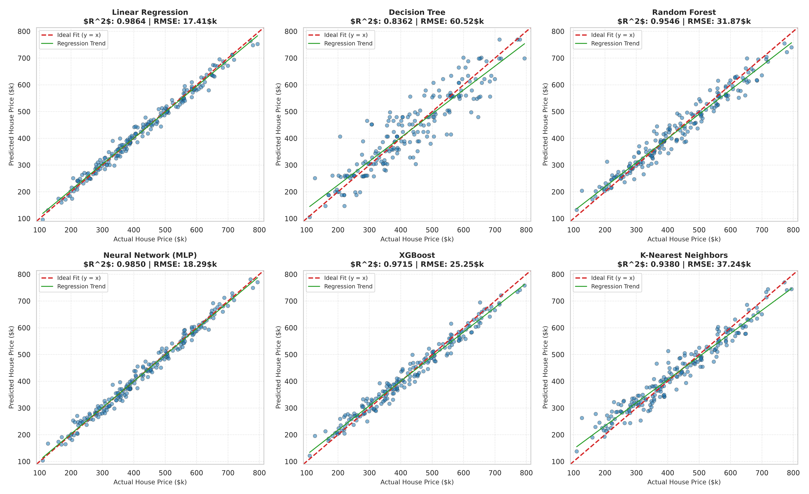
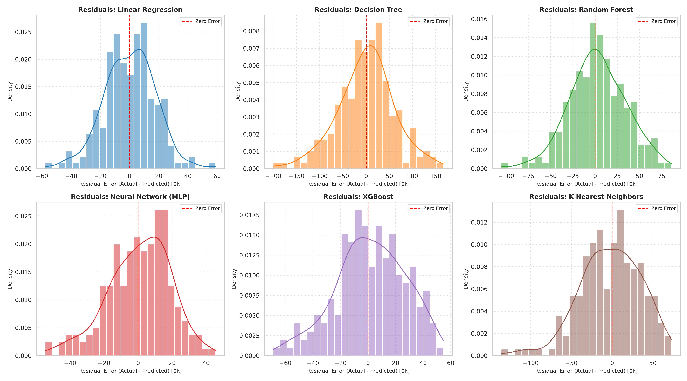
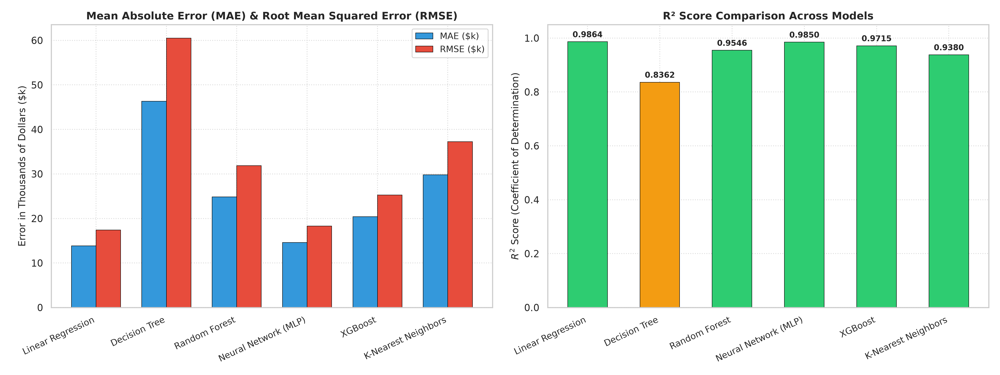

# Assignment 02: Comparative Implementation of Machine Learning Regression Algorithms

## 1. Experimental Setup

* **Dataset**: Real estate house price prediction (1,000 observations, 6 continuous/discrete features).
* **Target Variable**: Continuous market valuation (`Price` in $\$1,000s$).
* **Features**: `Square_Feet`, `Bedrooms`, `Bathrooms`, `Age_Years`, `Distance_City_Center`, `Location_Score`.
* **Partitioning**: 80:20 train/test split (800 training samples, 200 held-out test samples, `random_state=42`).
* **Feature Scaling**: `StandardScaler` fitted on training split and applied to test split for Linear Regression, MLP, and KNN. Tree-based algorithms operate directly on unscaled features.
* **Evaluated Algorithms**:
  1. Ordinary Least Squares Linear Regression
  2. Decision Tree Regressor (`max_depth=6`, `min_samples_split=10`)
  3. Random Forest Regressor (`n_estimators=150`, `max_depth=10`, `min_samples_split=5`)
  4. Multi-Layer Perceptron Regressor (`hidden_layer_sizes=(64, 32)`, `activation='relu'`, `solver='adam'`)
  5. XGBoost Regressor (`n_estimators=150`, `learning_rate=0.08`, `max_depth=5`, `subsample=0.8`)
  6. K-Nearest Neighbors Regressor (`n_neighbors=7`, `weights='distance'`)

---

## 2. Quantitative Performance Evaluation

Evaluated across the 200 held-out test observations:

| Algorithm | MAE ($\$k$) | MSE ($\$k^2$) | RMSE ($\$k$) | $R^2$ Score | Rank |
| :--- | :---: | :---: | :---: | :---: | :---: |
| **Linear Regression** | **13.8532** | **303.1889** | **17.4123** | **0.9864** | **1** |
| **Neural Network (MLP)** | **14.6067** | **334.6577** | **18.2937** | **0.9850** | **2** |
| **XGBoost Regression** | **20.3984** | **637.5038** | **25.2488** | **0.9715** | **3** |
| **Random Forest Regression** | **24.8342** | **1015.4149** | **31.8656** | **0.9546** | **4** |
| **K-Nearest Neighbors (KNN)** | **29.7992** | **1386.6759** | **37.2381** | **0.9380** | **5** |
| **Decision Tree Regression** | **46.3360** | **3662.5300** | **60.5188** | **0.8362** | **6** |

---

## 3. Visualizations

### 3.1 Actual vs. Predicted Parity Plots

### 3.2 Residual Error Distributions

### 3.3 Comparative Performance Metrics

---

## 4. Key Findings

* **Linear Regression Performance**: Linear Regression achieved the lowest RMSE ($17.4123\$k$) and highest $R^2$ ($0.9864$). Because the underlying property valuation function is dominated by additive physical characteristics (living area, room counts, location index), Ordinary Least Squares acts as the minimum-variance unbiased estimator (Gauss-Markov Theorem).
* **Neural Network Approximation**: The 2-layer MLP Regressor closely matched the linear baseline ($R^2 = 0.9850$, RMSE $= 18.2937\$k$). The network fitted both the primary linear planes and higher-order interaction terms, but required feature scaling and iterative epoch backpropagation without exceeding OLS accuracy.
* **Tree Quantization Errors**: Decision Trees ($R^2 = 0.8362$), Random Forests ($R^2 = 0.9546$), and XGBoost ($R^2 = 0.9715$) partition continuous feature space into orthogonal piecewise-constant hyper-rectangles. Approximating smooth linear hyperplanes via discrete axis-aligned steps incurs quantization error, which inflates residual variance compared to parametric estimators.
* **Curse of Dimensionality in KNN**: KNN recorded the second highest error (RMSE $= 37.2381\$k$, $R^2 = 0.9380$). In a 6-dimensional continuous space, distance concentration diminishes neighborhood local density, causing query predictions to average samples distributed across wider spatial radii.

All executable scripts and interactive workflows are available in [train_evaluate.py](./assets/train_evaluate.py) and [regression_comparison.ipynb](./regression_comparison.ipynb).
