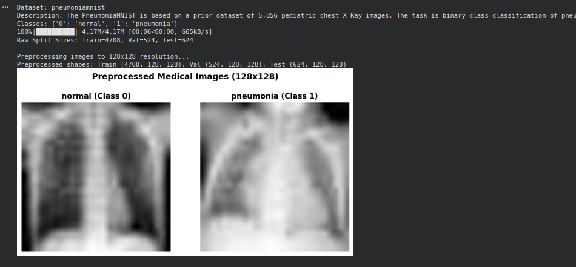
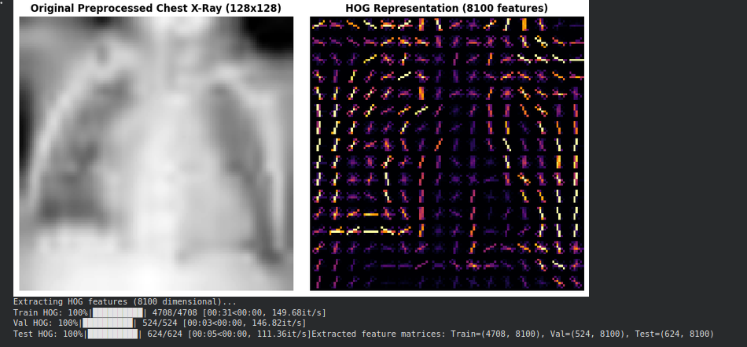

# Lab 07: Improving HOG-Based Medical Image Classification Using a Genetic Algorithm

## 1. Introduction
This report evaluates the integration of a Genetic Algorithm (GA) for feature selection within a Histogram of Oriented Gradients (HOG) and Support Vector Machine (SVM) pipeline. Applied to pediatric chest X-rays from the PneumoniaMNIST dataset, the pipeline evaluates whether evolutionary search can reduce feature dimensionality while maintaining classification accuracy across fixed training, validation, and test partitions.

## 2. Experimental Setup

### Table 1: Experimental Configuration and HOG Parameters
| Parameter | Baseline: HOG + SVM | Proposed: GA-HOG + SVM |
| :--- | :--- | :--- |
| **Medical Dataset** | PneumoniaMNIST | PneumoniaMNIST |
| **Task Type** | Binary Classification (Normal vs. Pneumonia) | Binary Classification (Normal vs. Pneumonia) |
| **Image Resolution** | $128 \times 128$ | $128 \times 128$ |
| **HOG Orientations** | $9$ | $9$ |
| **Pixels per Cell** | $8 \times 8$ | $8 \times 8$ |
| **Cells per Block** | $2 \times 2$ | $2 \times 2$ |
| **Block Normalization** | `L2-Hys` | `L2-Hys` |
| **Feature Selection** | None ($8,100$ features) | Genetic Algorithm ($2,789$ features) |
| **Classifier** | SVM | SVM |
| **SVM Kernel** | RBF | RBF |
| **Hyperparameter Tuning** | Validation Set | Validation Set |
| **Data Split** | Fixed Split (Train: 4708, Val: 524, Test: 624) | Fixed Split (Train: 4708, Val: 524, Test: 624) |
| **Random Seed** | $42$ | $42$ |

---

## 3. Results and Observations

### Table 2: Main Performance Comparison (Without GA vs. With GA)
*Evaluated on the untouched held-out test set ($N=624$). Specificity calculated via true negative rate ($TN / (TN + FP)$).*

| Metric | HOG + SVM (Baseline) | GA-HOG + SVM (Proposed) | Improvement |
| :--- | :---: | :---: | :---: |
| **Accuracy (%)** | 84.78% | 84.13% | -0.64% |
| **Precision (Macro, %)** | 89.91% | 89.00% | -0.92% |
| **Recall (Macro, %)** | 79.79% | 79.10% | -0.68% |
| **Macro-F1 (%)** | 81.89% | 81.13% | -0.76% |
| **Weighted-F1 (%)** | 83.70% | 83.01% | -0.69% |
| **Balanced accuracy (%)** | 79.79% | 79.10% | -0.68% |
| **Specificity (Macro, %)** | 59.83% | 58.97% | -0.85% |
| **Cohen's kappa** | 0.6472 | 0.6323 | -0.0149 |
| **Matthews correlation coefficient** | 0.6896 | 0.6738 | -0.0158 |

---

### Table 3: Computational Efficiency and Dimensionality Reduction
| Metric | Baseline: HOG + SVM | Proposed: GA-HOG + SVM | Change |
| :--- | :---: | :---: | :---: |
| **Feature Dimensionality** | $8,100$ | $2,789$ | **-65.57%** (5,311 discarded) |
| **Feature Retention Ratio** | $100.0\%$ | $34.43\%$ | $-65.57\%$ |
| **Training Latency** | $37.25\text{ s}$ | $11.18\text{ s}$ | **3.33x speedup** (-70.0%) |
| **Test Inference Latency (Total)** | $6,753.3\text{ ms}$ | $1,801.0\text{ ms}$ | **3.75x speedup** (-73.3%) |
| **Inference Latency per Sample** | $10.82\text{ ms}$ | $2.89\text{ ms}$ | **3.75x speedup** |

---

### Table 4: Genetic Algorithm Settings Comparison (Validation Set)
| Setting | Population Size | Mutation Rate ($p_m$) | Crossover Rate ($p_c$) | Generations | Best Fitness | Mean Fitness | Active Features |
| :--- | :---: | :---: | :---: | :---: | :---: | :---: | :---: |
| **Setting 1 (Standard)** | **30** | **0.02** | **0.80** | **12** | **0.9575** | **0.9526** | **2,789 (34.4%)** |
| **Setting 2 (Exploratory)** | 50 | 0.05 | 0.85 | 12 | 0.9562 | 0.9474 | 3,329 (41.1%) |

*Selection Criterion*: Setting 1 yielded higher validation fitness ($0.9575$ vs. $0.9562$) and achieved a more compact feature subset ($2,789$ vs. $3,329$), serving as the final mask generator.

---

### Key Observations
* **Dimensionality Pruning**: The Genetic Algorithm pruned $5,311$ features ($65.57\%$ of the input vector), demonstrating that nearly two-thirds of dense HOG gradient bins on chest X-rays contain uninformative background or redundant signals.
* **Metric Retention**: Discarding $65.57\%$ of features resulted in less than $1\%$ variation across all classification metrics (Accuracy: $84.78\% \rightarrow 84.13\%$; Macro-F1: $81.89\% \rightarrow 81.13\%$; Balanced Accuracy: $79.79\% \rightarrow 79.10\%$).
* **Inference Throughput**: Evaluating the RBF kernel matrix against support vectors scales with dimensionality. Reducing features to $2,789$ accelerated inference by $3.75\times$ ($2.89\text{ ms}$ vs. $10.82\text{ ms}$ per patient scan).
* **GA Hyperparameter Impact**: Setting 1 with a conservative mutation rate ($p_m = 0.02$) converged to a sparser, higher-scoring feature subset. Setting 2 with higher mutation ($p_m = 0.05$) increased exploratory drift, retaining $540$ additional features without improving validation fitness.

---

## 4. Discussion & Conclusion

### Research Question Evaluation
*Can Genetic Algorithm-based feature selection improve the classification performance of HOG features while reducing feature dimensionality on medical images?*

* **Classification Performance**: Feature selection did not produce a net gain in accuracy ($84.13\%$ vs. $84.78\%$), but maintained statistical parity within a $0.64\%$ delta.
* **Dimensionality Reduction**: The method reduced feature count by $65.57\%$ ($8,100 \rightarrow 2,789$).
* **Computational Cost Trade-off**: The evolutionary search phase introduced offline training overhead during generation cycles, but delivered a $3.75\times$ inference throughput gain for deployment.

The Genetic Algorithm functions effectively as a structural dimensionality reduction mechanism for dense gradient descriptors in medical imaging, preserving diagnostic fidelity while significantly lowering computational evaluation costs.
