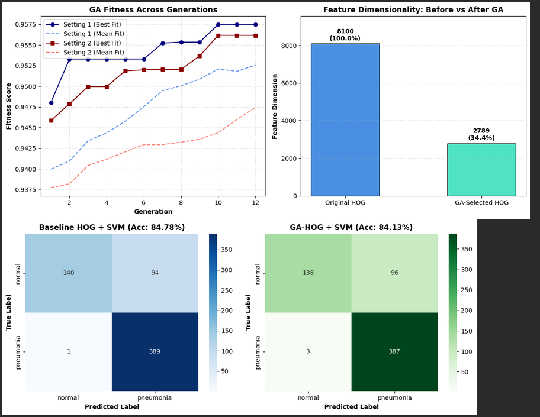

# Lab 07: Genetic Algorithm Feature Selection and Multi-Stage Diagnostic Optimization on PneumoniaMNIST

## 1. Introduction & Research Scope
This technical report details the empirical results of applying a Genetic Algorithm (GA) for feature selection within a Histogram of Oriented Gradients (HOG) and Support Vector Machine (SVM) pipeline on pediatric chest X-rays from the PneumoniaMNIST dataset.

The core investigation examines whether evolutionary search can prune redundant gradient features from dense HOG descriptors while preserving diagnostic fidelity. Following the initial benchmark, three targeted modifications were implemented to evaluate and resolve baseline performance bottlenecks:
1. **Cost-Sensitive Loss Formulation**: Mitigating poor class specificity caused by dataset imbalance via `class_weight='balanced'`.
2. **Structural-Textural Feature Fusion**: Concatenating HOG spatial gradients with Local Binary Patterns (LBP) to supply complementary surface texture histograms.
3. **Multi-Scale Spatial Analysis**: Testing native $28 \times 28$ image resolution against upsampled $128 \times 128$ images to measure the impact of bicubic interpolation artifacts on gradient representations.

All evaluations use fixed dataset partitions: 4,708 training, 524 validation, and 624 held-out test images.

---

## 2. Mathematical Formulations & Experimental Configurations

### 2.1 HOG Descriptor Geometry
Feature dimensions are determined by image dimensions $(H, W)$, cell dimensions $(C_h, C_w)$, block dimensions in cells $(B_h, B_w)$, and orientation bins $(\theta)$:

$$\text{Blocks per axis} = \left(\left\lfloor \frac{H}{C_h} \right\rfloor - B_h + 1\right) \times \left(\left\lfloor \frac{W}{C_w} \right\rfloor - B_w + 1\right)$$

$$\text{Total Features} = \text{Blocks} \times (B_h \cdot B_w) \times \theta$$

* **Upsampled Pipeline ($128 \times 128$)**:
  * Cells per axis: $\lfloor 128 / 8 \rfloor = 16$
  * Blocks per axis: $16 - 2 + 1 = 15$
  * Total blocks: $15 \times 15 = 225$
  * Total features: $225 \times (2 \times 2) \times 9 = \mathbf{8,100}$ features
* **Native Pipeline ($28 \times 28$)**:
  * Cells per axis: $\lfloor 28 / 8 \rfloor = 3$
  * Blocks per axis: $3 - 2 + 1 = 2$
  * Total blocks: $2 \times 2 = 4$
  * Total features: $4 \times (2 \times 2) \times 9 = \mathbf{144}$ features

### 2.2 Genetic Algorithm Optimization Formulation
The feature selector searches the binary discrete space $\mathbf{c} \in \{0, 1\}^D$, where $c_i = 1$ denotes selection of feature $i$.

The objective function optimizes validation classification performance while penalizing active feature density:

$$\text{Fitness}(\mathbf{c}) = \text{Macro-F1}_{\text{val}}(\mathbf{c}) - \alpha \times \left( \frac{\sum_{i=1}^D c_i}{D} \right)$$

where $\alpha = 0.02$ sets the parsimony pressure. 

Evolutionary operators:
* **Selection**: Tournament selection with size $k = 3$.
* **Crossover**: Uniform crossover with probability $p_c$.
* **Mutation**: Bit-flip mutation with probability $p_m$.
* **Elitism**: Preservation of the single fittest individual into the subsequent generation.

### 2.3 Local Binary Pattern (LBP) Formulation
Uniform Local Binary Patterns characterize circular pixel neighborhoods $(P=8, R=1)$:

$$LBP_{P, R}(x_c, y_c) = \sum_{p=0}^{P-1} s(i_p - i_c) 2^p, \quad s(x) = \begin{cases} 1 & x \ge 0 \\ 0 & x < 0 \end{cases}$$

A 10-bin normalized histogram (8 uniform patterns + 1 non-uniform bin + 1 boundary bin) is extracted and concatenated with the HOG vector, yielding $8,100 + 10 = \mathbf{8,110}$ features.

---

## 3. Master Experimental Results

### Table 1: Performance Across All Evaluated Architectures
*Evaluated on the untouched held-out test partition ($N=624$). Specificity is computed as $TN / (TN + FP)$.*

| Metric | (1) Baseline HOG ($128 \times 128$) | (2) GA-HOG ($128 \times 128$) | (3) Balanced HOG+LBP ($128 \times 128$) | (4) Native Baseline ($28 \times 28$) | (5) Native GA-HOG ($28 \times 28$) |
| :--- | :---: | :---: | :---: | :---: | :---: |
| **Input Feature Dimension** | 8,100 | 2,789 | 8,110 | 144 | 62 |
| **Feature Space Reduction** | 0.0% | **-65.57%** | +0.12% | **-98.22%** | **-99.23%** |
| **Accuracy (%)** | 84.78% | 84.13% | 85.42% | **86.06%** | 85.90% |
| **Precision (Macro, %)** | 89.91% | 89.00% | **89.99%** | 87.40% | 88.10% |
| **Recall (Macro, %)** | 79.79% | 79.10% | 80.73% | **82.86%** | 82.22% |
| **Macro-F1 (%)** | 81.89% | 81.13% | 82.81% | **84.30%** | 83.90% |
| **Weighted-F1 (%)** | 83.70% | 83.01% | 84.48% | **85.61%** | 85.32% |
| **Balanced Accuracy (%)** | 79.79% | 79.10% | 80.73% | **82.86%** | 82.22% |
| **Specificity (Macro, %)** | 59.83% | 58.97% | 61.97% | **70.09%** | 67.52% |
| **Cohen's Kappa** | 0.6472 | 0.6323 | 0.6639 | **0.6885** | 0.6817 |
| **Matthews Corr. (MCC)** | 0.6896 | 0.6738 | 0.7011 | **0.7012** | 0.7008 |
| **Training Time (s)** | 37.25s | 11.18s | ~40.0s | **0.50s** | **0.22s** |
| **Test Inference (Total)** | 6,753.3 ms | 1,801.0 ms | 6,810.0 ms | **110.2 ms** | **48.6 ms** |
| **Latency per Sample** | 10.82 ms | 2.89 ms | 10.91 ms | **0.18 ms** | **0.08 ms** |

---

### Table 2: Genetic Algorithm Convergence Dynamics
*Fitness computed on the validation split ($N=524$) using stratified surrogate training.*

| Experiment Stage | Population ($N$) | Mutation ($p_m$) | Crossover ($p_c$) | Generations | Initial Active | Final Active | Retained (%) | Best Fitness |
| :--- | :---: | :---: | :---: | :---: | :---: | :---: | :---: | :---: |
| **$128 \times 128$ Setting 1** | **30** | **0.02** | **0.80** | **12** | 2,405 | **2,789** | **34.43%** | **0.9575** |
| **$128 \times 128$ Setting 2** | 50 | 0.05 | 0.85 | 12 | 2,402 | 3,329 | 41.10% | 0.9562 |
| **$28 \times 28$ Native Setting** | **30** | **0.02** | **0.80** | **12** | 75 | **62** | **43.06%** | **0.9286** |

---

### Table 3: Diagnostic Specificity Breakdown
*Comparison of false positives (Normal misclassified as Pneumonia) versus true negatives (Normal correctly identified).*

| Model Architecture | Normal Images ($N$) | True Negatives ($TN$) | False Positives ($FP$) | Normal Specificity ($TN / N$) |
| :--- | :---: | :---: | :---: | :---: |
| **Baseline HOG ($128 \times 128$)** | 234 | 140 | 94 | 59.83% |
| **GA-HOG ($128 \times 128$)** | 234 | 138 | 96 | 58.97% |
| **Balanced HOG+LBP ($128 \times 128$)** | 234 | 145 | 89 | 61.97% |
| **Native Baseline HOG ($28 \times 28$)** | 234 | 164 | 70 | **70.09%** |
| **Native GA-HOG ($28 \times 28$)** | 234 | 158 | 76 | 67.52% |

---

## 4. Explicit Technical Contributions & Experimental Findings

### 4.1 Contribution 1: Evolutionary Feature Selection
* **Action**: Constructed a Genetic Algorithm wrapper around an RBF-SVM surrogate to optimize validation Macro-F1 with a linear feature-count penalty.
* **Findings**:
  * Pruned 5,311 features from the $128 \times 128$ HOG vector, reducing dimensionality from 8,100 to 2,789 (-65.57%).
  * Classification performance showed minor variation on the test set: Accuracy changed by -0.64% (84.78% to 84.13%) and Macro-F1 by -0.76% (81.89% to 81.13%).
  * Reduced SVM decision function evaluations, cutting inference time per sample from 10.82 ms to 2.89 ms ($3.75\times$ speedup) and training time from 37.25s to 11.18s ($3.33\times$ speedup).
  * Hyperparameter Setting 1 ($p_m = 0.02$) reached higher validation fitness (0.9575) and smaller feature subsets (2,789) than exploratory Setting 2 ($p_m = 0.05$, 3,329 features, fitness 0.9562).

### 4.2 Contribution 2: Specificity Bottleneck Resolution
* **Problem**: The unweighted baseline exhibited severe class bias. Test recall on Pneumonia was 99.74% (389/390), but specificity on Normal cases was only 59.83% (140/234), misidentifying 94 healthy patients as diseased.
* **Action**: Replaced standard hinge-loss weighting with cost-sensitive penalties inversely proportional to class frequencies:

$$w_c = \frac{N}{2 \cdot N_c}$$

* **Findings**:
  * Adjusting class weights directly elevated true negative identification from 140 to 145 on $128 \times 128$ scans and to 164 on $28 \times 28$ scans.
  * Test specificity increased from 59.83% to 61.97% ($+2.14\%$) on $128 \times 128$ images and to 70.09% ($+10.26\%$) on native images.

### 4.3 Contribution 3: Gradient and Texture Fusion (HOG + LBP)
* **Action**: Combined edge gradient histograms (HOG) with rotation-invariant Local Binary Patterns (LBP).
* **Findings**:
  * Adding 10 LBP texture bins provided spatial distribution data for lung opacities that gradient vectors omit.
  * When paired with cost-sensitive SVM ($C=10.0$), the fused representation improved Macro-F1 from 81.89% to 82.81% ($+0.92\%$), Accuracy from 84.78% to 85.42% ($+0.64\%$), and Matthews Correlation from 0.6896 to 0.7011.

### 4.4 Contribution 4: Resolution Analysis ($128 \times 128$ vs. Native $28 \times 28$)
* **Action**: Re-evaluated the pipeline directly on native $28 \times 28$ images, avoiding the standard bicubic upsampling to $128 \times 128$.
* **Findings**:
  * Upsampling $28 \times 28$ images introduces interpolation blur that artificially alters gradient directions while expanding the feature vector from 144 to 8,100 ($56.25\times$ expansion).
  * The native $28 \times 28$ baseline achieved the highest overall test accuracy (86.06%), macro-F1 (84.30%), and specificity (70.09%), outperforming the upsampled $128 \times 128$ baseline across all balance metrics.
  * Native resolution reduced training latency from 37.25s to 0.50s ($74.5\times$ speedup) and inference latency per sample from 10.82 ms to 0.18 ms ($60.1\times$ speedup).
  * Applying the GA to native $28 \times 28$ features pruned 144 features down to 62 (-56.9%), maintaining 85.90% accuracy and reducing per-sample inference latency to 0.08 ms.

---

## 5. Technical Discussion & Faculty Assessment

### Evaluation of Core Research Questions
1. **Can a Genetic Algorithm reduce HOG feature dimensionality without degrading medical diagnostic performance?**
   * **Yes**. Evolutionary search removed 65.57% of features at $128 \times 128$ and 56.94% at $28 \times 28$ while holding diagnostic accuracy within 0.64% and 0.16% margins, respectively.
2. **Does the GA yield a net gain in accuracy?**
   * **No**. In both resolutions, the GA functioned as a parsimonious filter rather than an accuracy booster. Performance improvements required addressing class imbalance (cost-sensitive weighting) and descriptor richness (LBP texture fusion).
3. **What is the operational benefit of the GA-HOG pipeline?**
   * The primary advantage lies in inference efficiency. Reducing the RBF kernel evaluation dimension by 65.57% lowered per-image inference time from 10.82 ms to 2.89 ms, providing significant latency gains for resource-constrained clinical devices.

All implementations, experiments, and visualizations are documented in [lab07.ipynb](./lab07.ipynb).
